<div align="center">

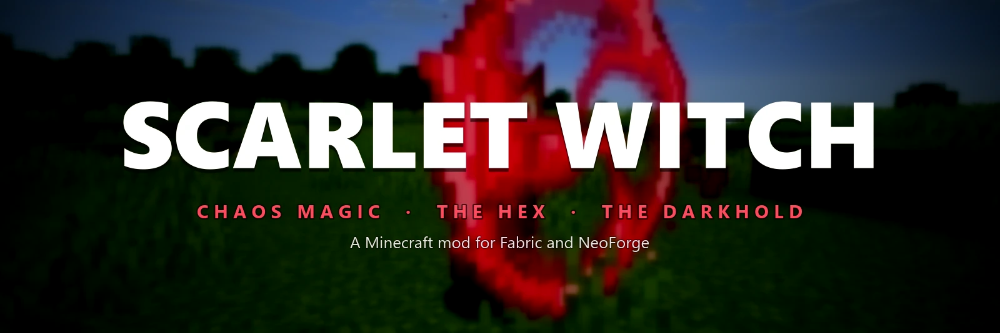

[](#compatibility)
[](#installation)
[](#installation)
[](#compatibility)

### Put on the tiara, weave on the costume, master her spells one by one,<br>and bend a whole town into a sitcom inside the Hex.

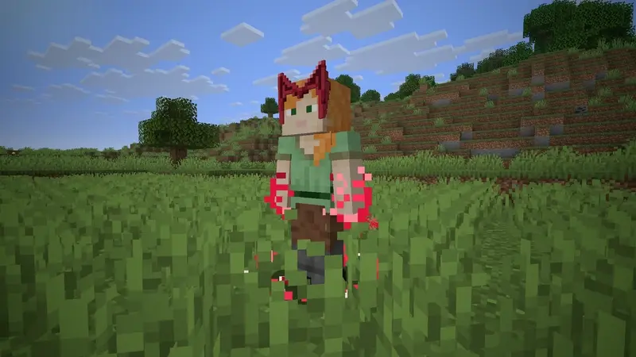

<!-- The full launch trailer goes on the line below: edit this file on github.com and drag "Scarlet Witch - Launch Trailer (GitHub upload).mp4" onto it, and GitHub turns it into a player. -->

[The crown](#the-crown-is-the-power) · [Chaos magic](#chaos-magic) · [The Hex](#the-hex) · [The Darkhold](#the-darkhold) · [Recipes](#recipes) · [Controls](#controls) · [Install](#installation)

</div>

<br>

Chaos magic inspired by the Scarlet Witch, for Minecraft 26.3 on Fabric and NeoForge. Every clip on this page is recorded in game.

## The crown is the power

<table>
<tr>
<td width="50%" valign="top">
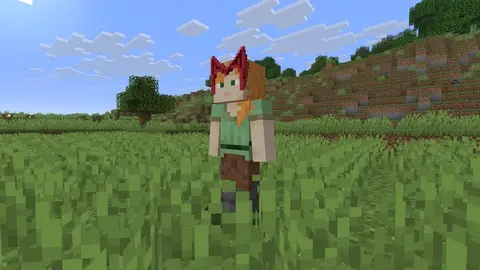
</td>
<td width="50%" valign="top">
<p> </p>
<p><b>Two crowns, the same powers:</b> the Scarlet Witch's tiara and the Scarlet Warlock's crown. Whoever wears one has the magic; take it off and the magic goes with it.</p>
<p><b>Suit up with <kbd>G</kbd>:</b> scarlet threads spiral up from your feet and the costume weaves on, the cape unfurling and the crown flaring last. Press it again and it burns away into embers.</p>
</td>
</tr>
</table>

- Worn in the helmet slot, a crown protects like a diamond helmet and never breaks. The two Scarlet crowns can be swapped in the crafting grid, keeping everything on them.
- **Mastery** grows as you cast and is stored on the crown, so a stolen crown carries everything its owner learned.
- **In creative**, a Scarlet crown has every power at once, at full strength, and its magic never runs dry. Mastery only grows in survival.

### Wiccan

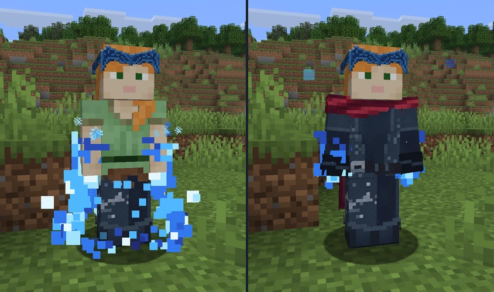

Equip **Wiccan's Crown** and press <kbd>G</kbd> to manifest Billy Maximoff's costume from *Agatha All Along*. Blue threads weave a midnight suit up from the boots; the red cloak unfurls behind the shoulder wrap, and the cobalt circlet flares last. Your own face stays visible. Press <kbd>G</kbd> again or take off the crown to dismiss the suit.

Craft Billy's crown with **iron ingot, amethyst shard, iron ingot** across the top and **lapis lazuli, iron ingot, lapis lazuli** beneath. You can also find it in the Scarlet creative tab or use `/give @s scarlet:wiccan_crown`.

**Billy's spell wheel:** Hold <kbd>R</kbd>, point at a spell, then release. Hold sneak while the wheel is open for the witchcraft page; release the wheel key before letting go of sneak. Cast with an empty main hand. Billy's crown earns its own mastery, and the costume is optional. See the [Wiccan field guide](docs/WICCAN.md) for spells, rituals and Demiurge form.

### Speed

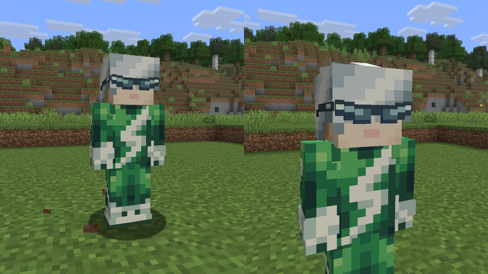

Equip **Speed's Goggles** in the head slot and press <kbd>G</kbd> to pull them down. Sprint to accelerate over half a second, jump higher, or mine faster with an empty main hand. With **Speed's Running Suit** in your inventory, the same key changes you into Tommy's green-and-white kit in a scuff of dust. Press it again to raise the visor and return to your own clothes.

Both items appear in the Scarlet creative tab. For the goggles, place leather at each end of the top row, then an orange stained glass pane, an iron ingot and another pane below. For the suit, use green and white wool in the pattern `GWG / WGW / G G`.

### Agatha Harkness

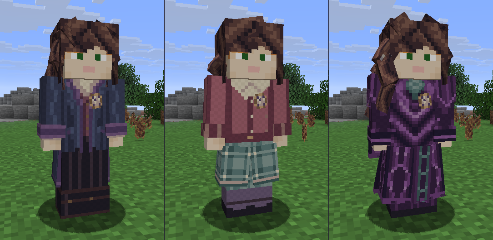

Equip **Agatha's Cameo Brooch** in your offhand and leave your head free of character crowns and Speed goggles. Hold **R** for the violet combat wheel, or **Shift + R** for witchcraft. Point at a spell and release **R** to select it. Right-click with an empty main hand to cast. From rank II, double-tap jump to fly while using another spell.

**Energy Absorption** is available from rank I. Hits from attackers fill the segmented siphon meter above your casting energy. Aim at an enemy spellcaster or player within 16 blocks and hold right-click. Even an empty meter gives you a brief drain. A full one sustains it for up to six seconds. Releasing, losing sight of the target, or moving too far away breaks the link. Each pulse damages the target and heals Agatha. A target that runs out of mastery starts turning grey and takes heavier damage.

The brooch gains mastery by draining another wearer's crown or brooch, or the innate magic of witches and other magical mobs. A lethal siphon also teaches compatible techniques the victim knew. A witch can teach Glamour and an evoker can teach Weave. Reading the **Darkhold** strengthens Agatha's native combat spells, lengthens her siphon and lets her leech health and casting energy on damaging hits.

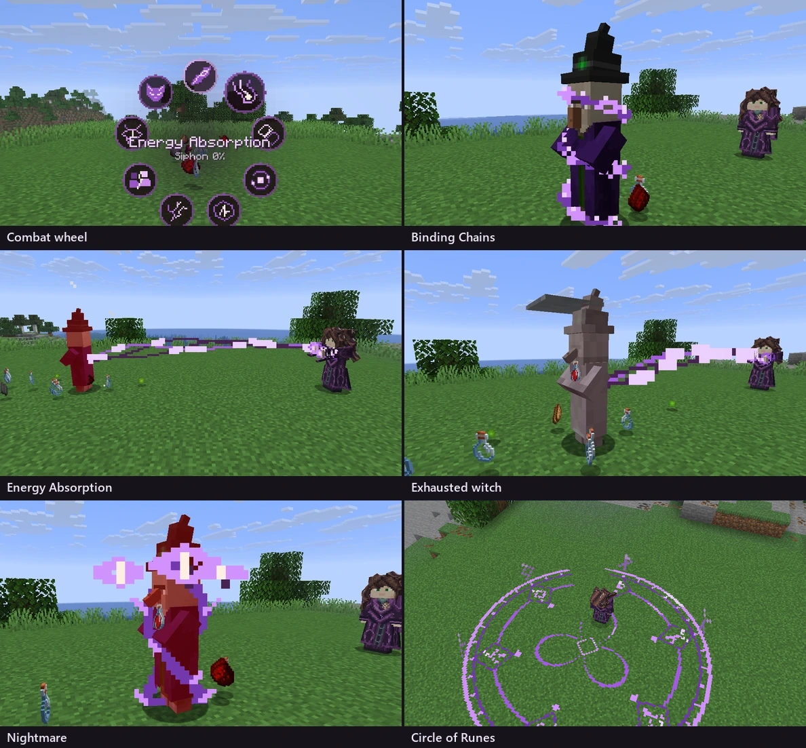

The combat wheel also holds Violet Blast, Binding Chains, Telekinesis, Circle of Runes, Malediction, Mirror Double, Nightmare and Spirit Familiar. Cast a rune on the ground to protect and empower Agatha inside it and bind and silence intruders. Witch Sight marks nearby magical creatures, undead and dropped enchanted items. Agatha shares Billy's grimoire leaves for learning witchcraft early. For a psychic conversation, cast **Dreambinding** within eight blocks of a sleeping player with four lit candle blocks around their bed. The sleeper uses `/wiccan dream accept`, either player can use `/wiccan dream say <message>`, and `/wiccan dream leave` ends the link.

While Agatha stands within the five-block radius of her Circle of Runes, hostile chaos bolts, witch potions and aimed spell beams extinguish at the boundary. The nearest standing rune flares at impact. Agatha and her teammates can cast outward. Stepping outside suspends this protection until she returns or the inscription expires.

A fresh brooch shows Agatha's traveling coat with your own skin's hair. **G** cycles unlocked outfits. **Shift + G** opens the wardrobe to choose an outfit and toggle **Agatha's hair** independently at any rank. The brooch remembers both choices. Agnes unlocks at rank V and the *WandaVision* finale robes appear when Agatha reaches rank IX. Creative opens all three immediately. Find the brooch in the Scarlet creative tab or use `/give @s scarlet:agatha_brooch`.

### Wandering Covens

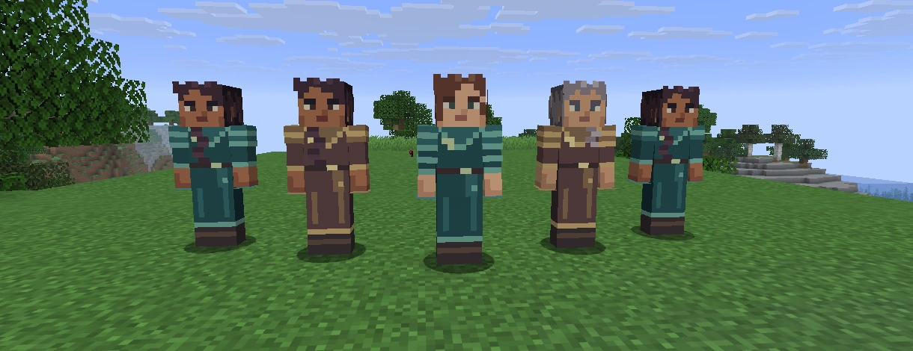

Groups of two to five human witches can visit the Overworld while you explore. Look for teal or pale-gold mantles. The witches roam together and defend their companions when attacked. A coven needs open surface ground near a player. Visits follow the mob-spawning game rule and occur on Easy, Normal and Hard.

An apprentice casts Starfire orbs. An adept also uses Arc Beam, and an elder can mark the ground with a binding rune. Step clear of the inscription before it closes. When a player defeats a witch, there is a one-in-three chance of finding the book for her tier. The same grimoires can appear in unopened structure chests. Look for Starfire in mineshafts and dungeons, Arc Beam in desert pyramids and jungle temples, and Binding Runes in stronghold libraries and woodland mansions.

Use a grimoire while wearing Wanda's or Billy's crown, or with Agatha's brooch equipped, to learn its spell on that item. Agatha can also take a coven member's signature spell by finishing her with Energy Absorption. The usual charge, range, line of sight and channel duration apply.

## Chaos magic

Hold <kbd>R</kbd> to open the spell wheel, aim at a spell and let go. Cast with **right click and an empty main hand**. Each spell opens up at its rank of mastery.

<table>
<tr>
<td width="50%" valign="top">
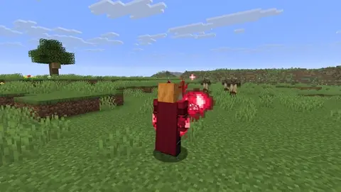
<p> <b>Chaos Bolt</b> &nbsp;<sub>RANK 1</sub><br>Fire blasts of scarlet energy.</p>
</td>
<td width="50%" valign="top">
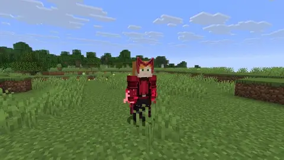
<p> <b>Chaos Shield</b> &nbsp;<sub>RANK 1</sub><br>Hold to raise a disc of energy that stops blows and turns projectiles back.</p>
</td>
</tr>
<tr>
<td width="50%" valign="top">
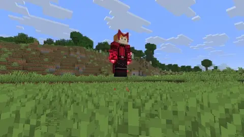
<p> <b>Levitation</b> &nbsp;<sub>RANK 2</sub><br>Double-tap jump to rise and fly, and keep casting in the air.</p>
</td>
<td width="50%" valign="top">
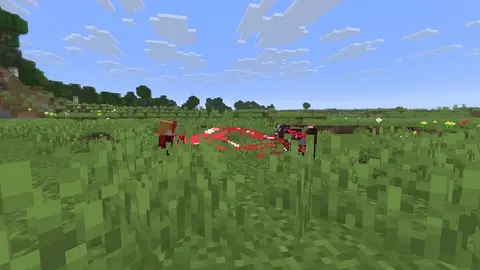
<p> <b>Telekinesis</b> &nbsp;<sub>RANK 3</sub><br>Grab, lift and throw creatures, players and blocks.</p>
</td>
</tr>
<tr>
<td width="50%" valign="top">
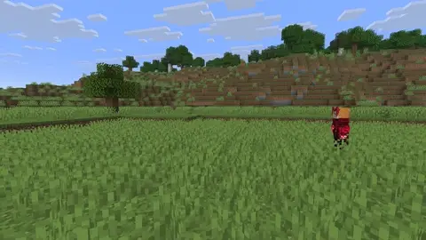
<p> <b>Red Mist</b> &nbsp;<sub>RANK 4</sub><br>Dissolve and reappear up to 12 blocks away.</p>
</td>
<td width="50%" valign="top">
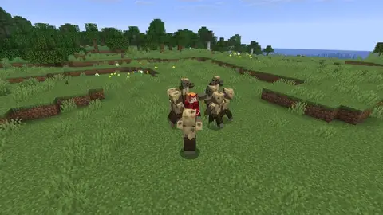
<p> <b>Shockwave</b> &nbsp;<sub>RANK 5</sub><br>A burst that throws everything back.</p>
</td>
</tr>
<tr>
<td width="50%" valign="top">
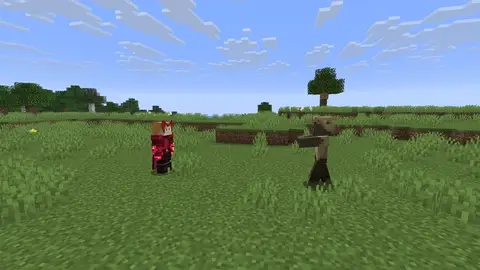
<p> <b>Mind Control</b> &nbsp;<sub>RANK 6</sub><br>Look out through a creature's eyes and steer it. Players only for a few seconds, and they can struggle free.</p>
</td>
<td width="50%" valign="top">
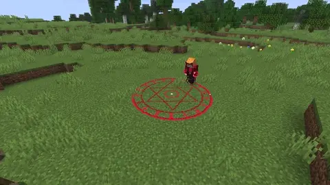
<p> <b>Rune Trap</b> &nbsp;<sub>RANK 7</sub><br>Write a sigil on the ground that binds whatever steps onto it.</p>
</td>
</tr>
</table>

Every power is drawn as hard-edged pixel art in stepped shades of scarlet, matched to Minecraft's own texels.

## The Hex

 <sub>RANK 10</sub> &nbsp;A hexagonal wall of static spreads 72 blocks out from you and stays where you cast it; hold the cast to grow it as far as 576. Anyone can walk in; you can kick them out. **Inside, the world is a sitcom.**

<table>
<tr>
<td width="50%" valign="top">
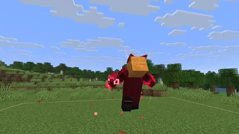
<p><b>Raise a Hex</b><br>Cast it and your sitcom home builds itself around you: frame, walls, roof and furniture.</p>
</td>
<td width="50%" valign="top">
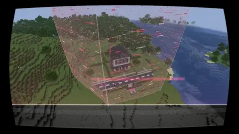
<p><b>It builds Westview</b><br>Your home, or a whole suburb with streets, lawns and picket fences, made over from whatever already stands rather than torn down.</p>
</td>
</tr>
<tr>
<td width="50%" valign="top">
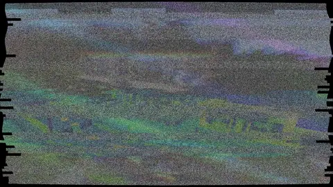
<p><b>Six sitcom eras</b><br>From 1950s black and white through 70s film color and 80s videotape to the present day, with era clothes for everyone inside, sound like an old television's speaker and a laugh track.</p>
</td>
<td width="50%" valign="top">
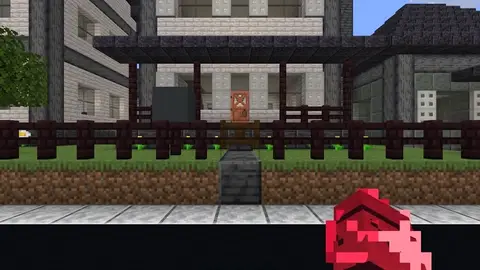
<p><b>Title cards</b><br>Every era opens on its own title card and note-block theme.</p>
</td>
</tr>
<tr>
<td width="50%" valign="top">
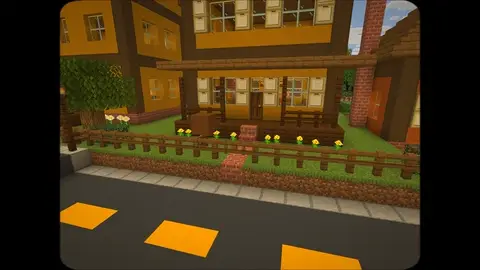
<p><b>Townspeople</b><br>Hostile mobs become townspeople with sitcom names who sit on couches, switch on the television, chat with their hands and wave as you pass.</p>
</td>
<td width="50%" valign="top">
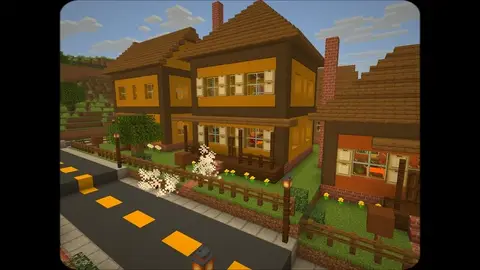
<p><b>Blasts mend themselves</b><br>Whatever a creeper or TNT breaks inside comes back, chests and all.</p>
</td>
</tr>
<tr>
<td width="50%" valign="top">
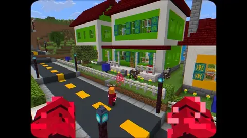
<p><b>Rewind the scene</b><br>Hold rewind and the last ten seconds run backward, shown the way that era's set would: film juddering through a 1950s projector, a VHS tape whining back with "REW" in the corner, a smooth scrub today.</p>
</td>
<td width="50%" valign="top">
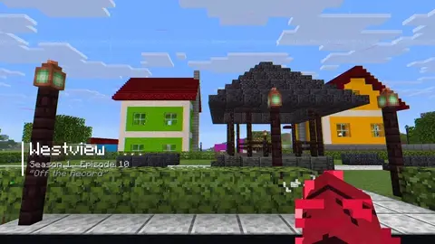
<p><b>The Showrunner remote</b><br>Press <kbd>H</kbd> to change the era, the time of day and the weather, start a new episode every morning, name your Hex, move your home and hold its rewind button.</p>
</td>
</tr>
<tr>
<td colspan="2" align="center" valign="top">
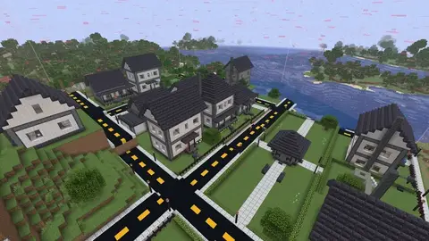
<p><b>The Hex falls</b><br>When it comes down, everything goes back the way it was.</p>
</td>
</tr>
</table>

- **Throw someone out** the way Wanda throws Monica out of Westview: they fly backward through the town, crashing straight through whatever stands in their way, bursting it open like a creeper's blast, and the Hex mends it like any blast. Out past the wall they hit the ground hard, skid, and lie winded before they get up.
- Creatures and players walk back the way they came, wounds close, broken blocks return and the fallen get back up. Nothing can be duplicated with the rewind: what someone has already picked up stays picked up.
- The remote also chooses what your Hex builds, and **makes over the one standing**: a town into an orchard and back, just your home, or nothing. **Your home always rises where you stand**, a different one each time you cast somewhere new, out of eight; cast standing in a home you raised before and that one comes back, its town with it.
- **Part the wall** and walk through where it stands open: there is no wall there to cross, so the picture doesn't roll over. From outside, the rest of the Hex stands beyond the opening.
- **Streets connect all through the town**, however the land lies: through hills in lit tunnels, over valleys, canyons and lakes on long, high bridges, never under water, in the era's own stone and concrete. Every house can be come to up steps from its sidewalk, holes in the ground are covered over, and orchard lanes do the same in timber.
- **No land in the Hex is left as it was:** ponds get boardwalks, slopes are laid in terraces, the edge of a drop becomes a lookout, and the floor of a canyon under the town's bridges fills with ball courts and picnic groves. Among the houses there are courts, groves and filling stations, and in the orchard, greenhouses, chicken coops, pumpkin patches and beehives.
- **Hit a townsperson and it hunts:** players first, then, with none about, the other townspeople, who wake and join it.
- **Townspeople turn up the town's way,** at home or out on its streets, a few at a time, never out of the dark on its roofs. **Out past where you can see, the show stops:** anyone out there finds the townspeople frozen and glitching, the picture drained and the laugh track gone.
- **Hexes of any size keep the game running smoothly**, build all the way out to their wall as they grow, and come down with it as they fall, whether you're there or not.
- **Set dressing:** standing in your own Hex, a panel beside your inventory holds every piece of era furniture and the car. Click one to take it out of thin air for a little chaos energy. It's the Hex's, though: carry it outside and it glitches away.
- **Era furniture that works:** drive the car with a friend beside you, keep food in the fridge and watch its door swing open, cook four things at once on the stove, toast bread, answer the telephone, sit down on the couch, switch on the television and hear its show, and read the time off the wall clock's turning hands. Each piece changes with the era, and all of it is craftable.
- **Cars you can drive properly:** every era's car has a cabin to see out of, a dash and a steering wheel that turns, wheels that roll and steer, and a body that leans into the road. Honk with the jump key. Run someone down and they go flying; drive into deep water and the engine floods; batter it with blows and spells and it dents, smokes and ends up a burning wreck.

## The Darkhold

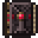 A late-game grimoire of carved stone and bronze. Read it and it rises out of your hand and floats open before you, turning its own pages.

<table>
<tr>
<td width="50%" valign="top">
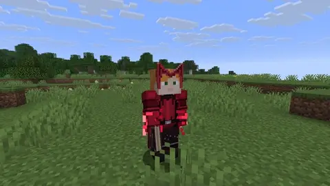
<p><b>It corrupts whoever reads it</b><br>Your magic darkens toward black-crimson for everyone who sees it, dark veins creep in at the edges of your sight, and it whispers.</p>
</td>
<td width="50%" valign="top">
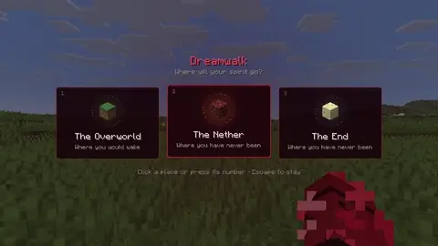
<p> <b>Dreamwalking</b><br>Your body sits down cross-legged and rises into the air while your spirit goes into a creature in any dimension, even the Nether or the End. A blow to your body snaps you back to defend it.</p>
</td>
</tr>
</table>

Past halfway it brings hunger, sleepless nights and worse. It fades once you stop.

## Recipes

<table>
<tr>
<td align="center" width="33%">
<br><b>Scarlet Witch's tiara</b>
<pre>G A G
R G R</pre>
</td>
<td align="center" width="33%">
<br><b>Scarlet Warlock's crown</b>
<pre>R A R
G G G</pre>
</td>
<td align="center" width="33%">
<br><b>The Darkhold</b>
<pre>E C E
C B C
E C E</pre>
</td>
</tr>
</table>

<sub><b>G</b> gold ingot · <b>R</b> redstone dust · <b>A</b> amethyst shard · <b>E</b> echo shard · <b>C</b> crying obsidian · <b>B</b> book</sub>

## Controls

| Key | Action |
|---|---|
| <kbd>G</kbd> | Suit up and down |
| <kbd>R</kbd> (hold) | Spell wheel |
| Right click, empty hand | Cast the chosen spell |
| Double-tap jump | Levitate (or bind a key of its own) |
| <kbd>H</kbd> | Showrunner remote |
| Rewind (bind a key) | Hold to rewind the last ten seconds inside your Hex |

## Settings and accessibility

Effects quality, reduce flashing, reduce camera shake, reduce screen effects, instant transformations, the cinematic camera when a Hex is founded, and era audio. Open the settings from the tiara in the corner of the Options screen, from the mod list on NeoForge, or with a key of your own.

## Multiplayer

The server decides what happens and every client sees it, so everything works on dedicated servers. Server owners can turn off Mind Control on players (or shorten it), the Darkhold's side effects, dreamwalking, and the rewind (or just leave other players out of it) in `config/scarlet-server.json`.

## Compatibility

- Minecraft 26.3, on Fabric (with Fabric API) or NeoForge. Java 25.
- Works with Sodium.
- Works with Iris shader packs on Fabric (tested with Complementary Reimagined). On NeoForge, Iris 1.11.7 currently crashes as a world loads with a shader pack on; the crash is inside Iris.
- Runs on both the OpenGL and Vulkan graphics backends.

## Installation

1. Install Minecraft 26.3 with [Fabric](https://fabricmc.net/use/installer/) and [Fabric API](https://modrinth.com/mod/fabric-api), or with [NeoForge](https://neoforged.net/).
2. Download the Scarlet Witch jar for your loader from the [releases](../../releases).
3. Drop it into your `mods` folder and start the game.

<details>
<summary><b>Building from source</b></summary>

<br>

With JDK 25 installed:

```
./gradlew build
```

The jars land in `fabric/build/libs` and `neoforge/build/libs`. `./gradlew :fabric:runClient` and `./gradlew :neoforge:runClient` open a development copy of the game.

</details>

## Credits

Made by Yashjit. Every texture is drawn by the mod's own generator (`tools/assetgen`) and every sound is one of Minecraft's own: nothing is taken from the films. The costumes take after Arrzee's Multiverse skins, used as reference only. See [CREDITS.md](CREDITS.md).

This is an unofficial fan work, not affiliated with or endorsed by Marvel or Disney. NOT AN OFFICIAL MINECRAFT PRODUCT. NOT APPROVED BY OR ASSOCIATED WITH MOJANG OR MICROSOFT.

© 2026 Yashjit. All rights reserved for now; see [LICENSE](LICENSE).
