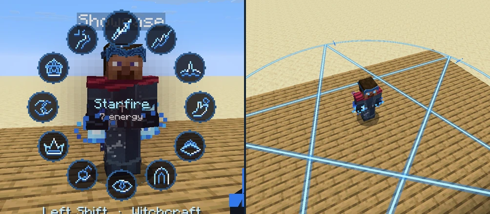

# Wiccan's field guide

Wear Wiccan's Crown. Hold **R**, point at an icon, and release **R** to select. Right-click with an empty main hand to cast. Holding sneak while the wheel is open switches to **Witchcraft**. Return the cursor to the center to cancel. These controls follow your key bindings.

## The main wheel

| Spell | Rank | Effect |
| --- | --- | --- |
| Starfire | I | A quick blue bolt that strikes the first living target in its path. |
| Arc Beam | II | Hold to sustain a blue beam; releasing stops its energy drain. |
| Shockwave | V | An outward blast throws nearby targets and projectiles back. |
| Telekinesis | III | Hold to seize an entity or block; release to throw it. |
| Starlight Weave | I | Builds a temporary solid platform over empty space in front of your feet. |
| Waygate | IV | First cast marks where you stand. Cast again to return; sneak-cast to replace the mark. The mark travels with the crown. |
| Second Sight | II | Reveals the direction of nearby presences, including enchanted item drops and crowned players. Only the caster sees the readings. |
| Astral Projection | V | Stand still to project into the viewpoint of a nearby creature for up to 15 seconds. Right-click to return; a blow to your body brings you back. No Darkhold required. |
| Demiurge | X | Starts a 20-second transformation with double reserves, stronger magic and three extra wheel slots. Its two-minute cooldown persists across relogs. |

**Flight** is always available from rank II: double-tap jump, as with Wanda. Spellcasting and flying work together.

## Witchcraft

| Spell | Rank | Effect |
| --- | --- | --- |
| Aegis | I | A ward grants absorption and brief damage resistance. Sneak-cast while ascended to raise a temporary ribbed dome. |
| Mirror Veil | IV | Conceals Billy and distracts nearby mobs already targeting him. |
| Transmutation | III | Cycles stone, andesite, diorite and granite. Casting at a starlight construct dispels it. |
| Mind Control | VI | Uses the mod's existing possession rules, including the server's settings for player targets. |
| Dreambinding | V | Opens a private, consensual dream thread at a candle-lit bed. |
| Dreamwalking | VI | Read at least one page of the Darkhold and carry it to reveal this spell. Choose a dimension; the usual corruption and return rules apply. |

**Study in survival:** Explore a mineshaft, swamp hut or ancient city while wearing the crown to discover the leaf for Transmutation, Mirror Veil or Dreambinding respectively. Use the leaf with the crown on to learn that spell ahead of rank and gain mastery. The discoveries are one-time rewards per player; the knowledge stays on the crown.

**Dreambinding:** Light four separate candle blocks within three blocks of a sleeping player's bed. Cast within eight blocks. The other player has 20 seconds to use `/wiccan dream accept`; they can still accept after waking. Both players can use `/wiccan dream say <message>` for private messages, `/wiccan dream share` to voluntarily show their own pack, and `/wiccan dream leave` to end the link. Ordinary chat stays public. A link lasts up to two minutes and closes on disconnect, changing dimensions apart, or the caster removing the crown.

## Demiurge

The blue hand rings, eye glow and star-lined cloak mark the change. The cloak appears when suited. The enlarged reserve drains even while idle. Divine spells disappear when the form ends.

| Divine spell | Effect |
| --- | --- |
| Twist of Fate | Diverts incoming projectiles for six seconds and recovers a little energy from each deflection. |
| Runic Domain | A ten-second, seven-block-radius pentacle protects Billy inside it and suspends nearby hostile mobs. It is separate from Wanda's town Hex. |
| Witches' Road | Opens passage to a separate dark-forest dimension. Cast again there, or use **`/wiccan return`** even without the crown, to return to the entry point. |

While ascended, **Starlight Weave** grows from 3x3 to 7x7. **Transmutation** with pink petals in the offhand permanently rewrites a 12x12x4 biome patch as cherry grove without replacing buildings or generating trees. This consumes a petal in survival. Server owners can disable it with `wiccanBiomeRewrite` in `scarlet-server.json`.
